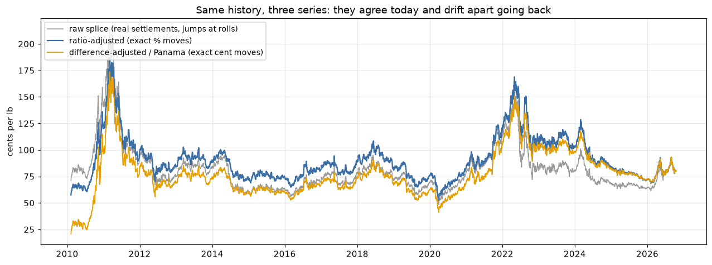

# Continuous futures prices: raw splice vs adjusted

How to join individual futures contracts into one long daily price series without creating moves that never happened. A worked example on **ICE Cotton No. 2, 2010–2026**.

A futures "price history" is really a chain of separate contracts. Each one starts thin, becomes the most traded, then empties out and expires. Splicing their prices together carelessly creates fake one-day moves at every switch. Those fake moves then distort every statistic and model built on the series: volatility, fat tails, momentum, stationarity.



*Raw spliced settlements (grey), ratio-adjusted (blue) and difference-adjusted "Panama" (orange). They agree today and drift apart going back. The Panama series falls to ~20c, though cotton never traded below 48c.*

## What's inside

| File | What it is |
|---|---|
| [`continuous_futures.ipynb`](continuous_futures.ipynb) | The walkthrough: builds the series step by step and measures each problem on real data (outputs included) |
| [`continuous_futures.py`](continuous_futures.py) | Reusable functions: load contracts, exchange calendar rules, roll schedule, chaining, ratio and Panama adjustment, problem-day flags, ADF/KPSS tests |
| [`wasde_release_dates.csv`](wasde_release_dates.csv) | USDA WASDE report release dates 2010–2026 (public data), used to flag report days |
| [`data/README.md`](data/README.md) | Expected format of the price files (no price data is included) |

## Seven problems, and what the data shows

| # | Problem | What goes wrong | Fix | Evidence (cotton 2010–2026) |
|---|---|---|---|---|
| 1 | **Roll gaps** | The switch between contracts shows up as a one-day "move" nobody earned | Measure each return **within one contract**, then chain | 42 of 66 rolls create a fake move bigger than a normal day; June 2022 splice shows **−18%**, the real move was −2.1% |
| 2 | **Old crop → new crop** | Jul → Dec jumps to a different supply/demand balance | Mark these rolls; use a crop-matched or new-crop-only series for crop questions | Jul→Dec gaps average −3.0%, worst **−15.9%** |
| 3 | **Notice period / expiry** | Distorted moves as positions close out | Roll before first notice, where traders actually switch | Volume switches 6–10 trading days before first notice → roll at 10 |
| 4 | **Thin contracts** | Settlements set without trading → fake "0% days" | Hold only the liquid contract; flag thin days | >40% of days have no trades more than a year from expiry; the chain has 2 stale days in 16 years |
| 5 | **Daily price limits** | A locked move spills into the next day → fake momentum | Flag limit days; test with and without | Next day continues 69% of the time; lag-1 autocorrelation **+0.07 → −0.007** without them |
| 6 | **Calendar gaps** | Multi-day returns; scheduled report days are more volatile | Flag gaps and report days | WASDE days move ~16% more than ordinary days |
| 7 | **Price levels drift** | Models on levels see trends and regime changes | Model log returns | ADF/KPSS: returns clearly stationary; levels not (borderline only on the full sample) |

**Effect on the statistics** (same days):

| | Clean chain | Careless splice | Free continuous series (Yahoo `CT=F`) |
|---|---|---|---|
| Biggest daily move | 7.1% | 18.0% | 27.3% |
| Excess kurtosis (fat tails) | 1.2 | 5.9 | 16.7 |

## Which adjusted series to use

| Series | Daily % moves | Price level | Use for |
|---|---|---|---|
| Raw splice | Wrong on roll days | Real | What actually traded |
| **Ratio-adjusted** | **Exact** | Not real before the last roll | Returns, volatility, % models |
| Difference-adjusted (Panama) | Distorted | Not real; can go negative | Cent P&L of a rolled position |

## Quick start

```bash
pip install -r requirements.txt
# put one CSV per contract in data/ (see data/README.md),
# or point to an existing folder instead (then restart Jupyter):
#   Windows:     setx FUTURES_DATA_DIR "D:\path\to\contracts"
#   macOS/Linux: export FUTURES_DATA_DIR=/path/to/contracts
jupyter notebook continuous_futures.ipynb
```

```python
import continuous_futures as cf
cal, contracts = cf.load_contracts("data")
a = cf.build_chain(contracts, cal, first="CTK10", first_prev="CTH10", days_before_fnd=10)
a["ratio_adj"] = cf.ratio_adjusted(a)      # use a.ret for modelling
flags = cf.flag_days(a)                    # limit, thin, stale, holiday_gap, after_limit
```

**Other markets:** set the contract `cycle` (e.g. all 12 months for crude oil), adapt `first_notice_day` to the exchange's rule and `limits` in `flag_days`, then run `volume_crossover` to choose the roll day.

## Data

Prices were downloaded from Barchart (daily settlements per contract) and **are not redistributed** here; the outputs in the notebook come from the author's run. WASDE dates are public USDA data.

*For education. Not investment advice.*
